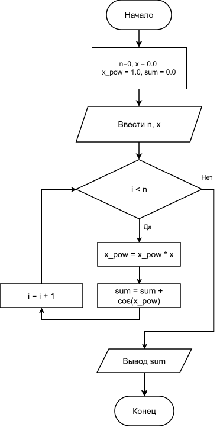

# Домашнее задание к работе 8

## Условие задачи (Вариант 18)

Вычислить для заданного натурального $n$ и действительного $x$ с использованием цикла `for` значение выражения $\cos x + \cos x^2 + \cos x^3 + \dots + \cos x^n$.

---

## 1. Алгоритм и блок-схема

### Алгоритм

1. Настроить русскую локализацию (`setlocale(LC_ALL, "RUS")`) для корректного вывода сообщений.
2. Инициализировать переменные: `n = 0`, `x = 0.0`, `x_pow = 1.0`, `sum = 0.0`.
3. Запросить у пользователя и ввести натуральное число `n` и действительное число `x`.
4. Запустить цикл `for` с параметром `i` от `1` до `n` включительно (`i <= n`) с шагом `1` (`i++`).
5. На каждом шаге цикла умножать `x_pow` на `x` для получения текущей степени $x^i$, вычислять `cos(x_pow)` и прибавлять результат к `sum`.
6. После завершения цикла вывести итоговое значение `sum` на экран.
7. Завершить работу программы.

### Блок-схема



---

## 2. Реализация программы

Исходный код программы: [8lab.c](8lab/8lab.c)

---

## 3. Результаты работы программы

Пример 1 (`n = 3`, `x = 1`):

```text
Введите натуральное n: 3
Введите действительное x: 1
Результат: 1.620907
```

Пример 2 (`n = 4`, `x = 0,5`):

```text
Введите натуральное n: 4
Введите действительное x: 0,5
Результат: 3.836740
```

Пример 3 (`n = 2`, `x = -0,5`):

```text
Введите натуральное n: 2
Введите действительное x: -0,5
Результат: 1.846495
```

---

## 4. Информация о разработчике

- **ФИО:** Хлебников Иван Алексеевич
- **Группа:** бОТИ-261
